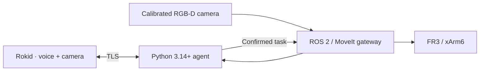

# Rokid Physical AI

**Voice and gesture interface for robot arms, using Rokid smart glasses.**

Point at an object. Say what you want done. Let your robot handle the movement.

Rokid Physical AI connects smart glasses to a physical AI agent through voice and first-person vision. The agent understands the task, asks for confirmation, and coordinates a robot arm through a dedicated motion controller.

- **Wearable interface:** voice, camera, and audio feedback on stock Rokid firmware.
- **Spatial context:** calibrated tabletop perception connects your gesture to an object.
- **Robot adapters:** a common task interface for different arms and parallel grippers.
- **Open architecture:** Android client, Python 3.14+ agent, and ROS 2 integration.

**Development preview.** Camera streaming, audio playback, local voice shutdown, and the glasses HUD have been checked on one stock Rokid device. Robot hardware qualification and the complete cloud-assisted manipulation scenario are pending.

## Architecture



## Get started

Start with the local diagnostic mode; it sends no media to a cloud provider:

```sh
uv sync --locked --all-groups
uv run rokid-agent serve --host <COMPUTER_LAN_ADDRESS> --diagnostic
```

Follow the [setup guide](https://ykshv.github.io/rokid-physical-ai/quickstart/) to install and pair the APK. Opening the application explicitly starts a session. With the local speech model configured, say **«выключись»** to finish.

| Component | Current evidence |
| --- | --- |
| Rokid RG-glasses, Android 12 / API 32 | Short device tests; see firmware and limitations in [verification](https://ykshv.github.io/rokid-physical-ai/verification/) |
| Franka Research 3 + Franka Hand | Gateway implementation and software checks; physical validation pending |
| UFACTORY xArm6 + parallel gripper | Gateway implementation and software checks; physical validation pending |

## Author and related work

Created and maintained by [Igor Yakushev](https://igor-ya.ru/). Related writing: [Physical AI and robot learning](https://igor-ya.ru/posts/physical-ai-robot-learning/) (Russian).

Related project: [Rula](https://github.com/ykshv/rula) is a local-first Russian voice avatar with local inference and a browser VRM interface.

[Русская инструкция](https://ykshv.github.io/rokid-physical-ai/ru/) · [Add a robot](https://ykshv.github.io/rokid-physical-ai/robots/) · [Development](docs/development.md) · [Agent instructions](AGENTS.md) · [Contributing](CONTRIBUTING.md)

[Documentation](https://ykshv.github.io/rokid-physical-ai/) · [License](LICENSE)
