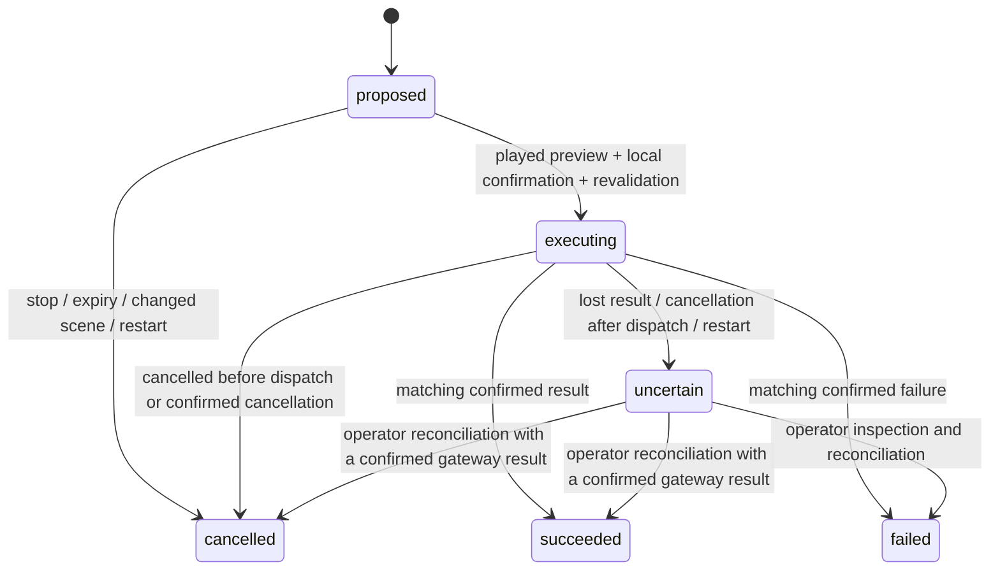

# Protocol invariants

The wire definitions live in `contracts.py` and `protocol.py`, not in this page. Generate their JSON schemas with `rokid-agent schemas`. This page explains sequencing and authority that field definitions alone cannot express.

## Device session

Pairing exchanges a single-use expiring code for an individual device credential over pinned TLS. Both WebSockets authenticate that credential. The server reserves one operator slot before accepting the control handshake; the session reserves one media slot before accepting its handshake. A media connection must belong to the same device. Handshake failure releases the reservation.

The device waits for `session.ready`, opens the media socket for that session, and sends `session.start`. Only `session.started` permits capture. Device-to-server control messages are a discriminated union: unknown types/fields and malformed acknowledgements fail closed. Diagnostic values are bounded and validated before logging.

Control carries heartbeat, session lifecycle and playback acknowledgements. Media carries binary PCM and JPEG frame messages upstream, and audio/clear messages downstream. Ordering is guaranteed within each socket, not between the two sockets. Playback may arrive before the control start callback finishes; the client buffers it until audio startup. Loss of either connection invalidates the session. A new connection requires a new explicit session; it does not restore motion permission.

Diagnostic mode has no provider or robot connection, even if the process environment contains robot configuration. The application factory rejects attaching a gateway in that mode.

## Proposal and commitment

| Step | Required authority |
| --- | --- |
| Select | Registered frame plus existing scene object/destination IDs; ambiguous or expired evidence requires clarification |
| Propose | The engine persists a `proposed` operation and creates the exact spoken description |
| Play | Narration transcript matches that description; only the device's actual playback completion opens the confirmation window |
| Confirm | Local recognition after the echo guard; fresh scene, matching calibration, destination and object geometry |
| Submit | Persist `executing` before the gateway request, with one operation ID and expiry |
| Complete | Accept only a result carrying that operation ID; the gateway requires observed placement |

Expired or invalidated confirmation cancels the proposal and releases the pending slot. Stop invalidates asynchronous proposal/confirmation reads before requesting the independent gateway stop. Device status delivery cannot prevent that request.

## Durable outcomes

An operation cancelled before its runner begins has not been submitted and can be recorded as cancelled. Once submission begins, transport cancellation cannot prove whether the robot received it: persist `uncertain`, request stop and require reconciliation. Repeated delivery must never repeat motion. A response for another operation is an error, including during operator reconciliation.

The agent's SQLite history and gateway journal record different sides of the boundary. Neither alone proves the physical result. Never clear an uncertain record by retrying, deleting state or creating a replacement operation. Follow [operations](operations.md).
